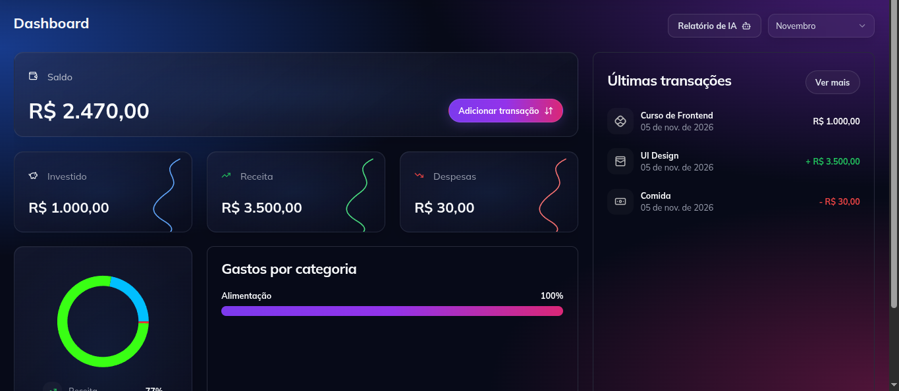
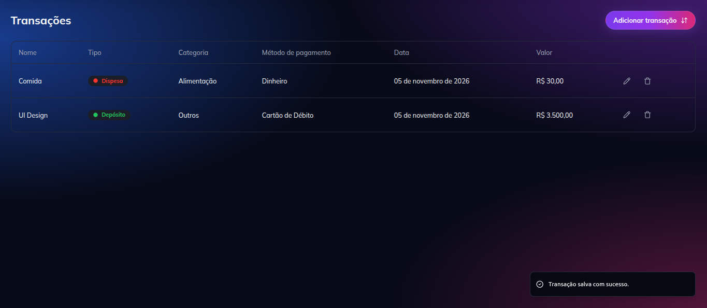
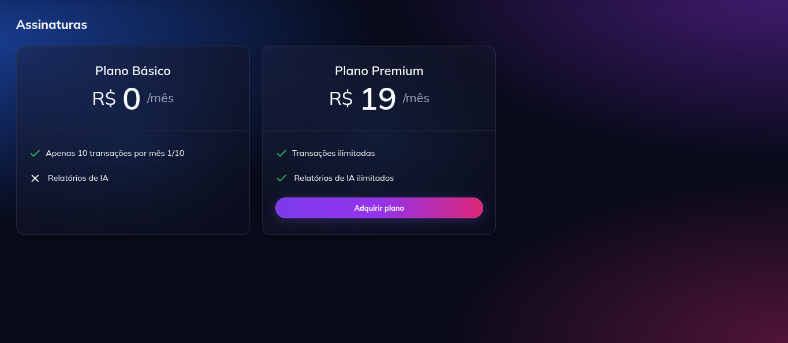

# Zaimu AI

**Zaimu AI** is a personal finance management platform built as a learning project to explore third-party integrations, subscription management, asynchronous event-driven communication through webhooks, component-driven development, and frontend testing strategies.

The platform allows users to track and manage their expenses, access premium features through Stripe subscriptions, and generate AI-powered financial reports using GPT.

## UI Design

  

  

  

## Features

- **Expense Management:** Track and manage personal expenses.
- **Premium Subscription:** Subscription management and payment processing through Stripe.
- **AI-Powered Reports:** Generate financial reports and insights using GPT.
- **Authentication & User Management:** Secure authentication and user management with Clerk.
- **Webhook Integration:** Handle asynchronous events and third-party service notifications.
- **Markdown Support:** Format and display generated reports using Markdown.
- **Component Development & Documentation:** Build, isolate, and document reusable UI components with Storybook.
- **Frontend Testing:** Practice unit, component, and end-to-end testing.

## Tech Stack

| Technology            | Purpose                                 |
| --------------------- | --------------------------------------- |
| Next.js               | Full-stack React framework              |
| TypeScript            | Static typing                           |
| Clerk                 | Authentication and user management      |
| Neon DB               | Serverless PostgreSQL database          |
| PostgreSQL            | Relational database                     |
| Prisma                | ORM and database management             |
| Stripe                | Subscription and payment management     |
| GPT                   | AI-powered financial reports            |
| Shadcn/UI             | UI components                           |
| Storybook             | Component development and documentation |
| Markdown              | Report formatting and rendering         |
| Vitest                | Unit and component testing              |
| React Testing Library | React component testing                 |
| Playwright            | End-to-end (E2E) testing                |

## Component Development

This project also explores component-driven development using **Storybook**, including:

- **Component Isolation:** Develop and test UI components independently from the main application.
- **Component Documentation:** Document component properties, variants, and expected behavior.
- **Visual Development:** Preview and interact with different component states.
- **Reusability:** Build consistent and reusable UI components across the application.

The goal is to improve component quality, maintainability, consistency, and the overall frontend development experience.

## Testing

This project is also intended to explore and practice frontend testing strategies, including:

- **Vitest:** Unit and component testing.
- **React Testing Library:** Testing React components from the user's perspective.
- **Playwright:** End-to-end (E2E) testing to validate complete user flows and application behavior.
- **Storybook:** Isolated component development, visual inspection, and documentation.

The goal is to improve code reliability, understand different testing approaches, and establish good testing practices in a modern frontend application.

## Project Goals

This project was created primarily to explore and practice:

- Integrating third-party services and APIs.
- Implementing subscription-based business models.
- Handling asynchronous events using webhooks.
- Managing authentication and user permissions.
- Integrating AI capabilities into a web application.
- Working with relational databases and ORM tools.
- Building modern full-stack applications with Next.js and TypeScript.
- Developing reusable and documented UI components with Storybook.
- Applying frontend testing strategies and automated testing.
- Understanding unit, component, and end-to-end testing.

## Getting Started

### Prerequisites

- Node.js
- PostgreSQL database (or a Neon DB instance)
- Clerk account
- Stripe account
- OpenAI API key

## Disclaimer

Zaimu AI is an educational project developed to explore modern web development practices, third-party integrations, AI capabilities, event-driven architectures, component-driven development, and frontend testing. It is not intended to be used as a production-ready financial application.

---

**Built for learning, experimentation, and exploring modern full-stack development.**
